  

  <picture>
    <source media="(prefers-color-scheme: dark)" srcset="./assets/now-dark.svg">
    
  </picture>

  <picture>
    <source media="(prefers-color-scheme: dark)" srcset="./assets/stack-dark.svg">
    
  </picture>

  <picture>
    <source media="(prefers-color-scheme: dark)" srcset="./assets/certifications-dark.svg">
    
  </picture>

  <a href="https://www.kaggle.com/sigmatango">
  <picture>
    <source media="(prefers-color-scheme: dark)" srcset="./assets/kaggle-dark.svg">
    
  </picture>
  </a>

